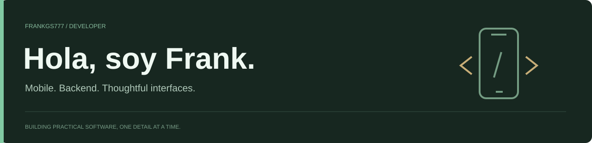

### Junior Mobile Developer · Java · SQL · Aplicaciones de gestion

Me interesa convertir procesos cotidianos en aplicaciones claras, utiles y cuidadas.

---

## Proyecto destacado

### Nexo ERP

Una edicion de portfolio que combina flujos comerciales, un backend Java y una demostracion interactiva de navegador. Cotizaciones, clientes, inventario y documentos ficticios, con una separacion explicita entre la muestra publica y cualquier uso empresarial.

**Java 25 · Spring Boot · Spring Security · SQL · JavaScript · CSS**

[Explorar la demo](https://frankgs777.github.io/nexo-erp/) · [Ver codigo y arquitectura](https://github.com/FrankGS777/nexo-erp) · [Leer sobre seguridad](https://github.com/FrankGS777/nexo-erp/blob/main/SECURITY.md)

## Mi espacio de trabajo

<table>
  <tr>
    <td width="33%"><strong>Aplicaciones</strong>  Desarrollo movil e interfaces que hagan mas sencillo el trabajo diario.</td>
    <td width="33%"><strong>Backend y datos</strong>  Java, servicios de aplicacion, SQL y flujos de negocio.</td>
    <td width="33%"><strong>Calidad</strong>  Pruebas, permisos claros y atencion a los detalles de la experiencia.</td>
  </tr>
</table>

## Mas codigo

| Proyecto | Enfoque | Repositorio |
| :-- | :-- | :-- |
| **Nexo ERP** | Operaciones comerciales, datos sinteticos y demo interactiva | [Explorar](https://github.com/FrankGS777/nexo-erp) |
| **Hoteleria Solec** | Proyecto publico con Java y JavaScript | [Ver repositorio](https://github.com/FrankGS777/HoteleriaSolec) |

---

Interfaces claras. Procesos con sentido. Aprendizaje constante.

